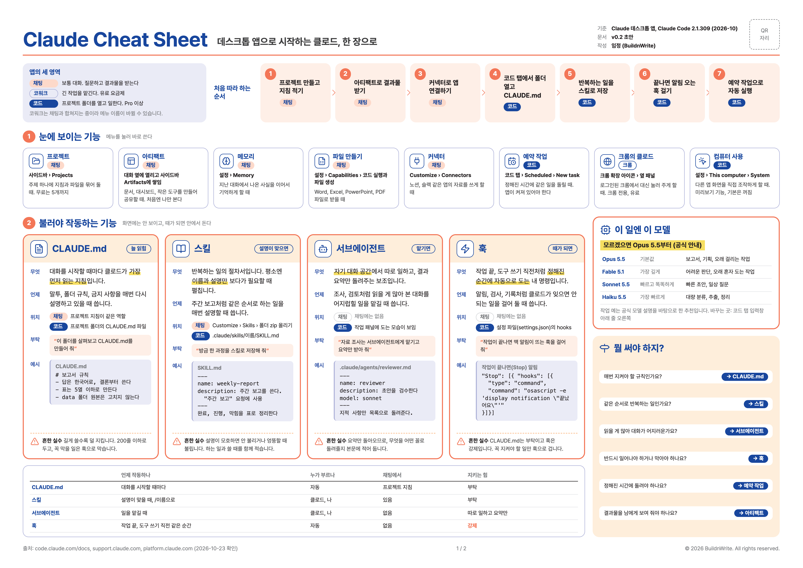
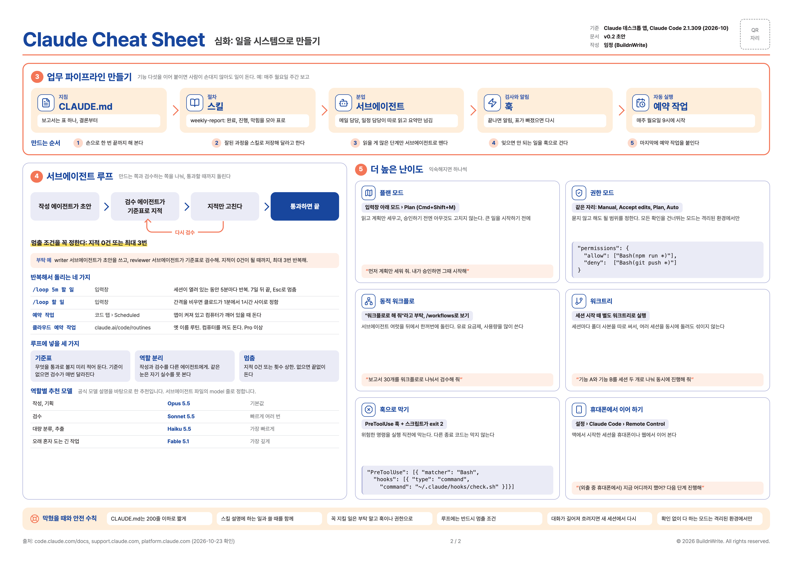

# 클로드 치트시트 / Claude Cheat Sheet

클로드 데스크톱 앱 기준으로 기능을 A3 앞뒤 두 면에 정리했습니다.

- **앞면, 기본**: 앱의 세 영역(채팅, 코워크, 코드), 처음 따라 하는 순서, 눈에 보이는 기능 8개, 불러야 작동하는 기능 4개(CLAUDE.md, 스킬, 서브에이전트, 훅), 이 일엔 이 모델
- **뒷면, 심화**: 업무 파이프라인 만들기, 서브에이전트 루프, 반복 실행, 플랜 모드와 권한 모드, 동적 워크플로, 워크트리, 안전 수칙

| 파일 | 설명 |
|---|---|
| [claude-cheatsheet-a3-ko.pdf](./build/claude-cheatsheet-a3-ko.pdf) | 인쇄용 A3 가로 2쪽 |
| [앞면 PNG](./build/claude-cheatsheet-a3-ko-front.png) | 기본 |
| [뒷면 PNG](./build/claude-cheatsheet-a3-ko-back.png) | 심화 |





## 기준

- Claude 데스크톱 앱, Claude Code 2.1.309 (2026-10)
- 기능 설명은 code.claude.com/docs, support.claude.com, platform.claude.com 공식 문서로 확인했습니다 (2026-10-23).
- 모델별 작업 예는 공식 모델 설명을 바탕으로 한 추천입니다.

## 고쳐서 다시 만들기

글은 `src/content.ko.json`, 모양은 `src/a3.html`, 색은 `src/design-tokens.json`에 있습니다. 고친 뒤 아래 명령으로 PDF와 PNG를 다시 만듭니다. Playwright와 Pretendard 글꼴이 필요합니다.

```bash
python3 src/build.py ko
```

---

© 2026 BuildnWrite. All rights reserved.
